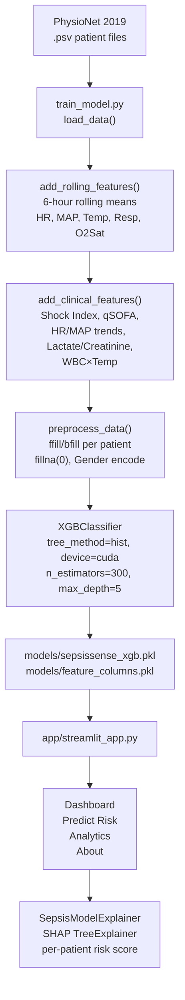

# 🩺 SepsisSense — AI-Powered Early Sepsis Detection


SepsisSense is a machine learning system for predicting sepsis onset in ICU patients using the [PhysioNet Challenge 2019](https://physionet.org/content/challenge-2019/1.0.0/) dataset. It provides an end-to-end pipeline — from raw `.psv` patient files to a Streamlit web application with SHAP-based explanations.

---

## Architecture



### Component Overview

| Component | File | Role |
|-----------|------|------|
| Preprocessing (class) | `src/preprocess.py` | `SepsisDataPreprocessor` — ffill/bfill, outlier capping, StandardScaler, LabelEncoder, temporal features |
| Feature Engineering (class) | `src/feature_engineering.py` | `SepsisFeatureEngineer` — rolling stats, trend/slope, stability, SOFA scores, interaction features |
| Training pipeline (functions) | `src/train_model.py` | `run_pipeline()` — loads `.psv` files, adds rolling + clinical features, trains XGBoost (GPU), saves model |
| Training pipeline (class) | `src/train_model.py` | `SepsisModelTrainer` — XGBoost + LightGBM, temporal patient-level split, comprehensive metrics |
| Explainability | `src/explain_model.py` | `SepsisModelExplainer` — SHAP TreeExplainer, per-patient waterfall/dashboard, global importance |
| Web application | `app/streamlit_app.py` | 4-page Streamlit app; loads `sepsissense_xgb.pkl` + `feature_columns.pkl`, live metrics |
| Test & demo generation | `test_demo.py` | `SepsisSenseTestSuite` — unit tests for all pipeline stages; `DemoDataGenerator` — CSV fixtures |
| End-to-end demo | `demo_script.py` | CLI demo of the full pipeline on synthetic data |

---

## Project Structure

```
sepsisence-ta-mlops-project/
├── app/
│   └── streamlit_app.py          # Streamlit web app (4 pages)
├── models/
│   ├── sepsissense_xgb.pkl       # Trained XGBoost model (generated by training)
│   ├── feature_columns.pkl       # Ordered feature list (generated by training)
│   └── feature_importance.png    # Top-20 feature importance chart (generated by training)
├── notebooks/
│   ├── 01_eda.ipynb              # Exploratory data analysis
│   ├── 02_feature_eng.ipynb      # Feature engineering experiments
│   ├── 03_modeling.ipynb         # Model development
│   └── 04_train_pipeline.ipynb   # Full training pipeline notebook
├── src/
│   ├── preprocess.py             # SepsisDataPreprocessor class + create_sample_dataset()
│   ├── feature_engineering.py    # SepsisFeatureEngineer class
│   ├── train_model.py            # SepsisModelTrainer class + run_pipeline() for PhysioNet data
│   ├── train_model_new.py        # Alternate trainer (XGBoost + LightGBM class version)
│   └── explain_model.py          # SepsisModelExplainer class (SHAP)
├── count_rows.py                 # Utility: counts PhysioNet .psv rows and prints split sizes
├── debug_models.py               # Debug script: tests all pipeline imports end-to-end
├── demo_script.py                # CLI demo on synthetic data
├── test_app.py                   # Minimal Streamlit smoke test
├── test_demo.py                  # Full test suite + DemoDataGenerator
├── DATA_DOWNLOAD.md              # PhysioNet data download instructions
├── QUICKSTART.md                 # Quick start guide
└── requirements.txt              # Python dependencies
```

> `physionet.org/` (raw training data) is excluded from version control via `.gitignore`.
> `models/*.pkl` files are also gitignored and must be generated locally by running the training pipeline.

---

## MLOps / ML Implementation

### Data

- **Source**: PhysioNet Challenge 2019 — pipe-separated `.psv` files, one per patient.
- **Structure**: Each file contains hourly ICU observations (vital signs + lab values + demographics + `SepsisLabel`).
- **Synthetic fallback**: `create_sample_dataset()` in `src/preprocess.py` generates realistic synthetic data when real data is unavailable.

### Training Workflow (`src/train_model.py → run_pipeline()`)

```
1. load_data(data_dir)            — glob all .psv files, concat with Patient column
2. add_rolling_features(df, window=6)  — 6-hour rolling means for HR, MAP, Temp, Resp, O2Sat
3. add_clinical_features(df)      — 7 derived features (see Feature Engineering below)
4. preprocess_data(df)            — per-patient ffill→bfill→fillna(0), Gender encoding
5. train_test_split(stratify=y, test_size=0.2)
6. train_model(X_train, y_train)  — XGBClassifier (GPU hist, 300 trees, depth 5, scale_pos_weight capped at 10)
7. evaluate_model(...)            — Accuracy, Precision, Recall, F1, ROC-AUC; saves feature_importance.png
8. save_model(...)                — joblib → models/sepsissense_xgb.pkl + models/feature_columns.pkl
```

Run with real PhysioNet data:
```bash
python -m src.train_model
```

### Feature Engineering

**Rolling features** (added in `add_rolling_features`):
- 6-hour rolling mean for: `HR`, `MAP`, `Temp`, `Resp`, `O2Sat`

**Clinical features** (added in `add_clinical_features`):

| Feature | Formula |
|---------|---------|
| `shock_index` | HR / SBP |
| `modified_shock_index` | HR / MAP |
| `qsofa_score` | (Resp ≥ 22) + (SBP ≤ 100) |
| `hr_trend_3h` | HR[t] − HR[t−3] per patient |
| `map_trend_3h` | MAP[t] − MAP[t−3] per patient |
| `lactate_creatinine_ratio` | Lactate / (Creatinine + 1e-6) |
| `wbc_temp_interaction` | WBC × Temp |

**Advanced features** (available via `SepsisFeatureEngineer` class):
- Rolling statistics across windows of 2, 4, 6, 8, 12 hours (mean, std, min, max, median, count, range, CV)
- Trend slopes and acceleration per vital over 4, 6, 8-hour windows (linear regression)
- Stability scores and variability trends per vital
- Change point detection (sudden changes vs. running std)
- Simplified SOFA sub-scores: respiratory (O2Sat), cardiovascular (MAP), renal (Creatinine), hepatic (Bilirubin), coagulation (Platelets)
- Interaction features: HR/MAP, HR/O2Sat, Lactate/MAP, Resp/O2Sat, shock indices
- Patient-specific baseline deviations (first 4 hours as baseline)

### Model

| Parameter | Value |
|-----------|-------|
| Algorithm | XGBoost (`XGBClassifier`) |
| `tree_method` | `hist` |
| `device` | `cuda` (falls back to CPU) |
| `n_estimators` | 300 |
| `max_depth` | 5 |
| `learning_rate` | 0.05 |
| `subsample` / `colsample_bytree` | 0.8 |
| `scale_pos_weight` | neg/pos ratio, capped at 10.0 |
| `eval_metric` | `auc` |

Alternative: `SepsisModelTrainer` class supports both XGBoost and LightGBM with temporal patient-level splits (train/val/test by patient ID, not by row).

### Inference Workflow (Streamlit app)

```
1. Load models/sepsissense_xgb.pkl + models/feature_columns.pkl
2. Collect patient input (manual form or built-in demo patient)
3. Build 10-record temporal sequence with slight variations
4. add_rolling_features() → add_clinical_features() → preprocess_data()
5. Align columns to feature_columns order, fill missing with 0
6. model.predict_proba(X)[:, 1] → risk score [0, 1]
7. SepsisModelExplainer.explain_single_prediction() → SHAP contributions
8. Display gauge, SHAP waterfall, feature importance bar chart
```

### Model Storage

Generated artifacts (not tracked in git):
- `models/sepsissense_xgb.pkl` — trained XGBoost model (joblib)
- `models/feature_columns.pkl` — ordered list of training feature names (joblib)
- `models/feature_importance.png` — top-20 feature importance plot

### Evaluation Metrics

The training pipeline computes and prints:

| Metric | Description |
|--------|-------------|
| ROC-AUC | Area under ROC curve |
| PR-AUC | Average precision score |
| F1 Score | Harmonic mean of precision and recall |
| Accuracy | Overall classification accuracy |
| Precision | Positive predictive value |
| Recall / Sensitivity | True positive rate |
| Specificity | True negative rate |
| Recall @ Precision ≥ 0.8 | Recall when precision threshold is met |

The Streamlit dashboard computes these metrics live at startup on a synthetic evaluation set built from the same preprocessing pipeline used during training.

### Class Imbalance Handling

- `scale_pos_weight` is automatically derived from the neg/pos ratio in the training set and capped at `10.0` to limit false alarms.
- `SepsisModelTrainer` uses `sklearn.utils.class_weight.compute_class_weight('balanced')`.

---

## Web Application

Run locally:
```bash
streamlit run app/streamlit_app.py
```
Opens at `http://localhost:8501`.

### Pages

| Page | Content |
|------|---------|
| Dashboard | Live model metrics (accuracy, ROC-AUC, F1, precision); sample patient demo with animated gauge and vital signs chart |
| Predict Risk | Manual patient entry form (vitals + labs); builds temporal sequence; returns risk score, SHAP bar chart, waterfall, clinical summary |
| Analytics | Validation metric charts (bar + grouped); synthetic dataset statistics |
| About | System description and medical disclaimer |

### Configurable Alert Threshold

A sidebar slider sets the `decision_threshold` (default `0.70`). The app implements a consecutive-hour alert filter: a confirmed sepsis alert fires only when risk exceeds the threshold for two consecutive hourly records.

| Threshold Range | Mode |
|-----------------|------|
| ≥ 0.70 | High Precision — fewer false alarms |
| 0.40 – 0.70 | Balanced |
| ≤ 0.40 | High Recall — catches more early cases |

---

## Development Workflow

### Setup

```bash
git clone <repo-url>
cd sepsisence-ta-mlops-project
pip install -r requirements.txt
```

### Data Download

See [DATA_DOWNLOAD.md](DATA_DOWNLOAD.md). Expected layout after extraction:

```
physionet.org/files/challenge-2019/1.0.0/training/
├── training_setA/    ← p000001.psv … 
└── training_setB/    ← p100001.psv …
```

The app runs without real data — it generates synthetic patients automatically.

### Train Model (PhysioNet data)

```bash
python -m src.train_model
```

### Run End-to-End Demo (synthetic data)

```bash
python demo_script.py
```

### Generate Test Data and Run Test Suite

```bash
python test_demo.py
```

Runs 5 test stages: preprocessing → feature engineering → model training → explainability → end-to-end scenarios. Results saved to `data/processed/test_results.json`.

### Debug Pipeline Imports

```bash
python debug_models.py
```

### Count PhysioNet Dataset Size

```bash
python count_rows.py
```
*(Update `data_dir` in the script to your local path.)*

### Linting

```bash
flake8 src/ app/
black src/ app/
```

---

## Dependencies

Core libraries (from `requirements.txt`):

| Library | Purpose |
|---------|---------|
| `xgboost` | Primary model |
| `lightgbm` | Alternative model |
| `scikit-learn` | Preprocessing, metrics, splits |
| `shap` | Model explainability |
| `streamlit` | Web application |
| `plotly` | Interactive charts |
| `pandas`, `numpy` | Data processing |
| `scipy` | Rolling regression, peak detection |
| `joblib` | Model serialization |
| `matplotlib`, `seaborn` | Feature importance plots |

---

## Deployment Notes

- No Docker, Kubernetes, or CI/CD configuration files are present in this repository.
- The app is designed to be run locally or deployed to [Streamlit Community Cloud](https://streamlit.io/cloud).
- GPU training (`device="cuda"`) is used when available; XGBoost falls back to CPU automatically.
- No patient data is persisted by the application — all processing is in-memory per session.

---

## Medical Disclaimer

⚠️ This system is for research and educational purposes only. It is not approved for clinical use without proper validation and regulatory approval. Always consult qualified healthcare professionals for medical decisions.

---

*Dataset: PhysioNet Challenge 2019 (ODbL License — see [DATA_DOWNLOAD.md](DATA_DOWNLOAD.md))*
