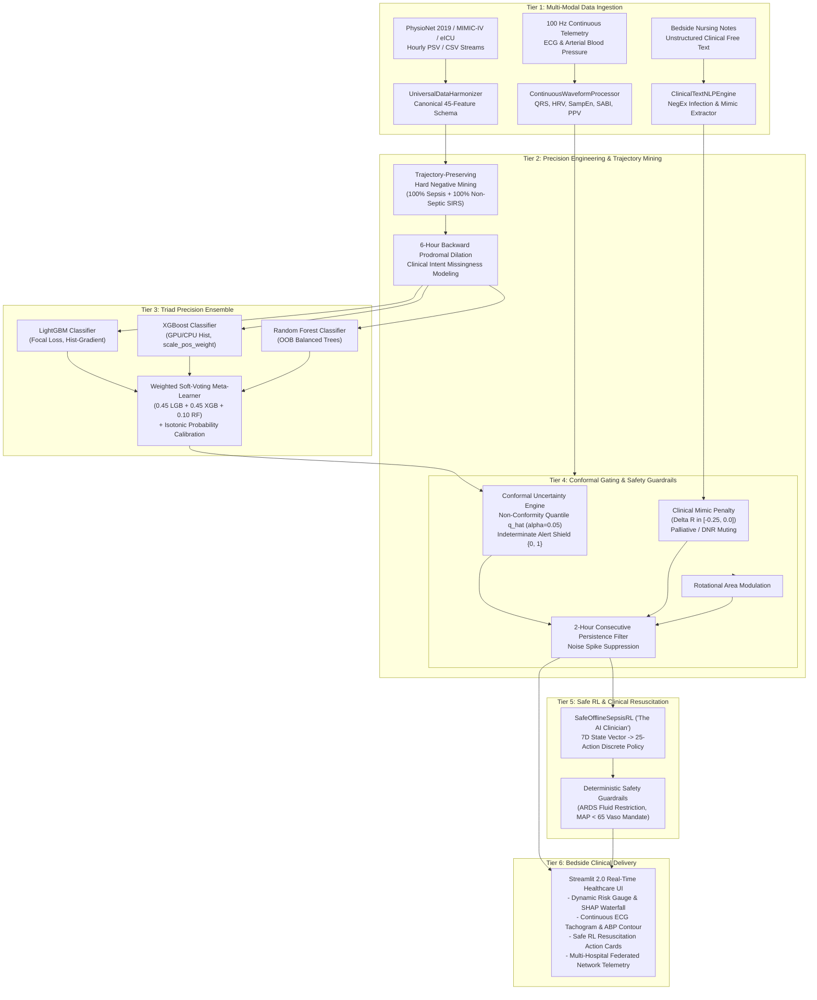

# 🩺 SepsisSense — Early Sepsis Prediction with Alarm-Fatigue-Aware Safety Layers (Research Prototype)

[](https://github.com/suriyaprakash-25/SepsisSense)
[-success?style=for-the-badge&logo=pytest)](https://github.com/suriyaprakash-25/SepsisSense)
[](https://www.python.org/)
[](https://streamlit.io/)
[](https://xgboost.readthedocs.io/)
[](LICENSE)

**SepsisSense** is a research prototype for early sepsis prediction in the ICU, trained and evaluated on the **PhysioNet/CinC 2019 Challenge** dataset (Sepsis-3 labels, hourly vitals and labs).

The project focuses on **clinician alarm fatigue**: it prioritises specificity and calibrated probabilities over raw sensitivity, then adds safety layers (conformal uncertainty gating and a persistence filter) to suppress unreliable alerts. Several further research directions (path signatures, clinical NLP, waveform HRV, federated learning, safe RL) are implemented as **prototype modules** and are not yet validated on real patient data. See [Validated Results](#-validated-results-held-out-physionet-2019) and [Limitations](#-limitations--honest-assessment).

---

## 📑 Table of Contents

- [Key Capabilities & Clinical Edge](#-key-capabilities--clinical-edge)
- [System Architecture](#-system-architecture)
- [Research Modules](#-research-modules)
- [Validated Results](#-validated-results-held-out-physionet-2019)
- [Model improvement research](#-model-improvement-research)
- [Limitations & Honest Assessment](#-limitations--honest-assessment)
- [Project Directory Structure](#-project-directory-structure)
- [Multimodal Bedside Clinical UI](#-multimodal-bedside-clinical-ui)
- [Automated Verification & Test Harness](#-automated-verification--test-harness)
- [Quickstart & Installation](#-quickstart--installation)
- [Clinical & Executive Reports](#-clinical--executive-reports)
- [Medical Disclaimer](#-medical-disclaimer)

---

## ⚡ Key Capabilities & Clinical Edge

Status key: ✅ trained & evaluated on real PhysioNet data · 🧪 implemented & unit-tested, demonstrated on synthetic/simulated data only

1. ✅ **Research-informed ensemble trained on all 40,336 PhysioNet patients (GPU)**: tuned XGBoost + LightGBM on 185 features with a utility-weighted loss and isotonic calibration. **ROC-AUC 0.858 on 8,068 held-out patients**; the alert catches 70% of septic patients while alerting 12% of non-septic patients (see [results](#-validated-results-held-out-physionet-2019) and [research](#-model-improvement-research)).
2. ✅ **Early-warning labelling**: 6-hour backward label dilation, so the model is trained to flag the hours *before* Sepsis-3 onset.
3. ✅ **Imbalance handling**: trajectory-preserving hard negative mining keeps all septic and non-septic SIRS ("look-alike") patients.
4. ✅ **Missingness-as-signal features**: lab-ordering patterns used as a proxy for clinical suspicion.
5. ✅ **2-hour persistence filter**: an alert must persist across consecutive hours, which suppresses isolated sensor spikes.
6. 🧪 **Conformal uncertainty gating**: split-conformal prediction sets (α = 0.05); alerts are withheld when the set is indeterminate ($\Gamma = \{0, 1\}$).
7. 🧪 **Rough path signatures**: Level-1/Level-2 iterated integrals and (HR, MAP) Lévy area as features robust to irregular sampling.
8. 🧪 **Clinical-note NLP**: rule-based phrase matching with NegEx negation to flag infection signs and sepsis mimics (post-op pain, anxiety, ambulation).
9. 🧪 **Waveform analytics**: Pan-Tompkins QRS detection, time/frequency HRV, Sample Entropy and ABP pulse-pressure variation. No real 100 Hz ICU waveforms have been used yet.
10. 🧪 **Federated learning with DP-SGD**: simulated 4-node federation (logistic model, L2 clipping, Gaussian noise). It does **not** train on MIMIC-IV / eICU / HiRID; the node names are labels in the simulation.
11. 🧪 **Safe-RL treatment recommender**: a 7-D state and a 25-action (fluid × vasopressor) grid, bounded by Surviving Sepsis Campaign guardrails. **The Q-function is not trained** (random initialisation), so recommendations are currently driven by the deterministic guardrails.

---

## 🏛 System Architecture



---

## 🔬 Research Modules

> All six modules below are **🧪 prototypes**: implemented and unit-tested, but not yet integrated into the trained pipeline or validated on real patient data. The literature listed under "Inspiration" motivated each design; this project does not reproduce those papers' results.

### 1. Conformal Uncertainty Filtering
* **Inspiration**: COMPOSER (Shashikumar, Nemati et al., *npj Digital Medicine*, UC San Diego).
* **Status**: 🧪 Tested on synthetic data; not yet calibrated on the held-out PhysioNet split.
* **Module**: [`src/conformal_uncertainty.py`](src/conformal_uncertainty.py)
* **Mechanism**: Solves for conformal non-conformity quantile $\hat{q}$ on hold-out calibration data at significance level $\alpha = 0.05$ (guaranteeing 95% marginal coverage). Produces prediction sets $\Gamma^{0.05}(\mathbf{x}) \subseteq \{0, 1\}$. When ensemble trees diverge ($\sigma_{\text{ensemble}} > 0.15$), outputs **$\Gamma = \{0, 1\}$ [Indeterminate]** and suppresses the alert, instructing clinicians: *"Uncertainty elevated. Alert withheld to prevent alarm fatigue. Re-check serum lactate and vitals."*

### 2. Rough Path Signatures & Hemodynamic Shock Loops
* **Inspiration**: Signature-based approach of the PhysioNet/CinC 2019 winning team (Morrill, Kormilitzin, Lyons et al., Oxford).
* **Status**: 🧪 Feature extractor implemented and tested; not yet added to the trained model's feature set.
* **Module**: [`src/path_signatures.py`](src/path_signatures.py)
* **Mechanism**: Models irregular vital streams as geometric paths $X(t) = (t, \text{HR}, \text{MAP}, \text{Resp}, \text{Temp})$. Extracts Level-1 displacements and Level-2 iterated integrals:
  $$A_{i, j} = \frac{1}{2} \int_0^T \Big( (X_i(s) - X_i(0)) dX_j(s) - (X_j(s) - X_j(0)) dX_i(s) \Big)$$
  The $(HR, MAP)$ **Shock Loop Area** isolates the rotational phase-space trajectory of circulatory collapse (tachycardia with collapsing blood pressure) from benign exertion (concordant HR and BP increases).

### 3. Bedside Clinical Text NLP (NegEx Integration)
* **Inspiration**: NegEx (Chapman et al., 2001) and clinical literature on sepsis mimics.
* **Status**: 🧪 Rule-based; tested on hand-written example notes. PhysioNet 2019 has no free text, so it has not been evaluated on real notes (MIMIC-IV-Note would be the next step).
* **Module**: [`src/clinical_nlp.py`](src/clinical_nlp.py)
* **Mechanism**: Parses unstructured nursing shift notes using rule-based phrase matchers and NegEx negation scope detection:
  * **Infection Phenotypes**: Detects altered mental status, mottled extremities, rigors, purulent sputum, and urosepsis.
  * **Mimic Disambiguation**: Identifies post-operative pain, panic/anxiety, and physical therapy ambulation, applying risk modulation ($\Delta R \in [-0.25, 0.0]$) to prevent false alerts.
  * **Palliative Care Shield**: Automatically mutes alarms for Comfort Measures Only (CMO) or Do Not Resuscitate (DNR) patients.

### 4. Continuous Waveform High-Frequency Ingestion (ECG & ABP)
* **Inspiration**: Pan & Tompkins (1985) QRS detection; literature linking reduced HRV and entropy to sepsis.
* **Status**: 🧪 Signal-processing functions tested on generated ECG/ABP signals. No real ICU waveform data (e.g. MIMIC-III Waveform) has been processed yet, and no lead-time claim has been validated.
* **Module**: [`src/waveform_analytics.py`](src/waveform_analytics.py)
* **Mechanism**: Designed for 100 Hz telemetry. Extracts Pan-Tompkins QRS complexes, time-domain HRV (SDNN, RMSSD, pNN50), Welch spectral power (LF, HF, LF/HF) and Sample Entropy. From arterial blood pressure (ABP) it measures pulse pressure variation (PPV ≥ 13% suggests fluid responsiveness) and $dP/dt_{\max}$. The dashboard shows an illustrative autonomic-blunting score derived from these features.

### 5. Multi-Center Federated Learning with Differential Privacy
* **Status**: 🧪 **Simulation only.** Four in-process "hospital" clients holding synthetic non-IID data train a logistic-regression model. No real multi-centre data is involved; the hospital names (MIMIC-IV, AmsterdamUMCdb, eICU, HiRID) are labels in the simulation.
* **Module**: [`src/federated_learning.py`](src/federated_learning.py)
* **Mechanism**:
  * Client-side DP-SGD: $L_2$ gradient clipping ($C = 1.0$) and Gaussian noise injection.
  * A simple cumulative ε counter (not a formal Rényi-DP accountant).
  * FedAvg-style aggregation weighted by client sample size.
  * **Known issue**: the FedProx proximal term currently evaluates to zero (`global_weights - global_weights`), so the code behaves as FedAvg.

### 6. Safe Offline Reinforcement Learning ("The AI Clinician")
* **Inspiration**: The AI Clinician (Komorowski et al., *Nature Medicine* 2018) and the Surviving Sepsis Campaign 2021 guidelines.
* **Status**: 🧪 **The Q-function is untrained** (random initialisation; no offline-RL training loop exists yet). Recommendations are currently driven by the deterministic guardrails below. Training with Conservative Q-Learning on MIMIC-IV trajectories is future work.
* **Module**: [`src/safe_reinforcement_learning.py`](src/safe_reinforcement_learning.py)
* **Mechanism**: Evaluates a 7D normalized clinical state vector $(\text{MAP}, \text{Lactate}, \text{Shock Index}, \text{SOFA}, PaO_2/FiO_2, \text{Urine Output}, \text{Fluid Balance})$ over a 25-action grid (5 fluid tiers $\times$ 5 vasopressor tiers), bounded by hard clinical safety guardrails:
  * **ARDS / Hypoxemia**: Fluid capped to $\le 250\,\text{mL}$ when $PaO_2/FiO_2 < 200$.
  * **Hypervolemia**: Fluid prohibited when cumulative balance $> 5,000\,\text{mL}$.
  * **Refractory Shock**: Vasopressors unconditionally initiated when $\text{MAP} < 65\,\text{mmHg}$.
  * **Weaning**: Active vasopressor taper when $\text{MAP} \ge 75\,\text{mmHg}$ and $\text{Lactate} < 1.5\,\text{mmol/L}$.

---

## 📊 Validated Results (held-out PhysioNet 2019)

**Model v3** is trained on **all 40,336 patients** in the PhysioNet/CinC 2019 training data with [`src/train_full.py`](src/train_full.py) on an NVIDIA RTX 4050 laptop GPU (XGBoost on CUDA; the full run takes under 5 minutes, most of it feature engineering). Its recipe was chosen by the literature review and controlled experiments described in [Model improvement research](#-model-improvement-research) below.

**Patient-level split** (stratified by hospital system and sepsis status): **70% train** (28,235 patients, 2,052 septic) · **10% calibration** (4,033, 293 septic) · **20% held-out test** (8,068, 587 septic). Test patients are never used for fitting, model selection, calibration or choosing the threshold; the web app replays only these patients.

**Alert rule**: calibrated risk ≥ **6.06%** for two consecutive hours (causal persistence filter). The threshold was chosen on the calibration split as the best official PhysioNet 2019 utility that alerts at most **15% of non-septic patients**, a cap that limits alarm burden.

### Held-out test split: 8,068 patients

Source: [`models/precision_metrics.json`](models/precision_metrics.json); the web app recomputes the same numbers live (Model facts page and `/api/public/summary`).

| Metric | v2 | **v3** | Notes |
|:---|:---:|:---:|:---|
| ROC-AUC | 0.833 | **0.858** | Hour-level discrimination |
| PR-AUC | 0.114 | **0.141** | +24%; about 7.8× the 0.018 positive-hour rate |
| Brier score | 0.0169 | **0.0165** | Calibration error after isotonic regression |
| PhysioNet 2019 normalised utility | 0.359 | **0.392** | 0 = never alert, 1 = perfect. The 2019 challenge winner scored about 0.36 on the hidden test set (not directly comparable) |
| **Recall**: septic patients with ≥ 1 alert | 368 / 587 (62.7%) | **412 / 587 (70.2%)** | 44 more septic patients caught |
| Non-septic patients with ≥ 1 alert | 932 / 7,481 (12.5%) | **897 / 7,481 (12.0%)** | 35 fewer false alarms |
| **Precision** (PPV) of alert hours | 11.2% | **12.9%** | 2,682 TP / 20,722 alert hours |
| Recall of positive hours | 45.4% | **47.8%** | 2,682 / 5,607 |
| Specificity (hours) | 93.3% | **94.1%** | |
| Hour-level accuracy | 92.4% | **93.2%** | Dominated by the 98% of negative hours, so not a useful headline metric |

**Confusion matrix (hours, v3)**: TN 285,023 · FP 18,040 · FN 2,925 · TP 2,682

**By hospital system** (held-out test, v3):

| | Set A | Set B |
|:---|:---:|:---:|
| Patients (septic) | 4,067 (358) | 4,001 (229) |
| ROC-AUC | 0.833 (v2 0.803) | 0.883 (v2 0.862) |
| PR-AUC | 0.131 (v2 0.112) | 0.161 (v2 0.117) |
| PhysioNet utility | 0.397 (v2 0.358) | 0.385 (v2 0.361) |
| Septic patients alerted | 251 / 358 | 161 / 229 |
| Non-septic patients alerted | 579 / 3,709 | 318 / 3,772 |

**Other operating point**: the pure utility maximum (threshold 2.6%) reaches a calibration utility of 0.446 but alerts many more non-septic patients; the 15% cap keeps alarm burden at about 1 in 8 patients.

### Model history

| | v1 | v2 | **v3** |
|:---|:---:|:---:|:---:|
| Training data | 3,000-patient subset | all 40,336 | all 40,336 |
| Features | 67 | 67 | **185** |
| Loss | class-weighted | class-weighted | **utility-weighted** |
| Models | XGB + LGB + RF | XGB + LGB + RF | **XGB + LGB (tuned)** |
| Held-out ROC-AUC | 0.685 (1,500 stays) | 0.833 | **0.858** |
| Septic patients alerted | 9 / 138 (6.5%) | 368 / 587 (62.7%) | **412 / 587 (70.2%)** |
| PhysioNet utility | −0.73 (internal split) | 0.359 | **0.392** |

Older models are kept in `models/v1_backup/` and `models/v2_backup/` (git-ignored); `python src/train_full.py --recipe v2` reproduces v2.

### What this means

- **Better on both fronts**: compared with v2, v3 catches 44 more septic patients *and* raises 35 fewer false alarms on the same held-out patients.
- **The cost is still false alarms**: about 1 in 8 patients who never develop sepsis receive at least one alert, and about 1 in 8 alert hours fall within 6 hours of onset. An alert is a prompt to review, not a diagnosis.
- **A quiet tool is still not reassurance**: about 3 in 10 septic patients are never alerted.

> ⚠️ `demo_output/demo_results.json` reports AUC ≈ 0.9998. That run uses the **synthetic** cohort from `src/preprocess.py` and does not reflect real-world performance.

---

## 🔬 Model improvement research

The v3 recipe came from a review of the PhysioNet/CinC 2019 literature, turned into controlled experiments ([`src/experiments_v3.py`](src/experiments_v3.py), results in [`models/experiments_v3.json`](models/experiments_v3.json)).

**What the literature suggested**

| Technique | Evidence |
|:---|:---|
| Measurement-process features (missingness, counts, recency), vital deltas and variance | Du et al. (2nd place, utility 0.345): 40 variables + 34 missingness flags + deltas + variance; Yang et al.: 168 features from missingness, clinical scores and time series |
| Partial SOFA, BUN/creatinine, rolling min/max | Morrill et al. (Oxford, 1st place): signatures over PartialSOFA, BUN/Cr and MAP, 6 h min/max look-back |
| Utility-weighted loss | Hammoud et al.: the challenge utility is maximised by a weighted 0-1 loss; weight each hour by \|U(1) − U(0)\| |
| Tuned gradient boosting | Most top-5 entries were tuned boosted trees (Bayesian or cross-validated tuning) |
| Check another hospital | All top-5 teams scored negative utility on the organisers' hidden third hospital |

**Protocol**: training patients were split again 85 / 15 into inner-train and inner-validation; every variant was compared on inner-validation only. Calibration and test patients were not touched until the final model.

**Inner-validation results** (4,236 patients):

| Variant | ROC-AUC | PR-AUC | Utility @ ≤15% cap | Septic alerted |
|:---|:---:|:---:|:---:|:---:|
| E0 v2 recipe | 0.821 | 0.111 | 0.346 | 65.6% |
| E1 + 118 new features (185) | 0.834 | 0.121 | 0.356 | 65.3% |
| E2 + native missing values, no RF | 0.836 | 0.117 | 0.356 | 67.5% |
| E3 + tuned boosting, early stopping | 0.833 | 0.136 | 0.368 | 68.5% |
| E4 + utility-weighted loss | 0.840 | 0.148 | 0.369 | 68.5% |
| E5 = E3 without ICULOS / HospAdmTime | 0.827 | 0.144 | 0.349 | 66.6% |
| E6 tuned E4 (XGB depth 4 + LGB 127 leaves) | 0.845 | 0.147 | 0.361 | 68.5% |

E3/E5 early-stopped on PR-AUC, which halted LightGBM after 2 trees; E6 re-tuned E4 with ROC-AUC early stopping and longer patience. Removing the time-in-hospital features (E5) cost 0.006 ROC-AUC and 0.02 utility.

**Cross-hospital generalisation** (train on one hospital system's training patients, test on the *other* system's held-out patients):

| | ROC-AUC v2 → v3 | PR-AUC v2 → v3 | Utility @ cap v2 → v3 |
|:---|:---:|:---:|:---:|
| Train A → test B | 0.768 → 0.775 | 0.064 → 0.082 | 0.267 → 0.261 |
| Train B → test A | 0.750 → 0.769 | 0.087 → 0.090 | 0.213 → 0.135 |

Both recipes lose about 0.09 ROC-AUC at a hospital they have never seen. v3 still ranks patients better, but its alert utility transfers worse from B to A, so calibration and threshold must be re-tuned at any new site before use.

**Sources**: [PhysioNet 2019 challenge papers](https://physionet.org/content/challenge-2019/1.0.0/papers/index.html) · [Morrill et al., signature-based model](https://www.cinc.org/2019/Program/accepted/14.html) · [Hammoud et al., optimal sample weighting](https://aminer.org/pub/5e5e196293d709897ce693ef/early-prediction-of-sepsis-using-gradient-boosting-decision-trees-with-optimal-sample) · [Reyna et al., analysis of the challenge (top teams on the hidden hospital)](https://arxiv.org/pdf/2012.11013) · [Yang et al., multi-feature fusion XGBoost](https://alpha.physionet.org/files/challenge-2019/1.0.0/papers/CinC2019-020.pdf?download)

---

## 🧭 Limitations & Honest Assessment

- **Single dataset, weak cross-site transfer**: both test sets come from PhysioNet 2019 (two US hospital systems). Trained on one system and tested on the other, ROC-AUC falls to about 0.77. External validation (e.g. MIMIC-IV / eICU) and per-site calibration are needed before any real use.
- **Length-of-stay shortcut is weaker but not gone**: in the manual assessment, the same deteriorating vitals score 10.7% at ICU hour 30 and 12.7% at hour 120 (v2: 8.1% vs 16.6%; v1: 4.8% vs 27.6%). In ward replays, time in ICU and cumulative measurement counts (which also grow with length of stay) can still be top drivers. Next experiment: replace cumulative counts with counts over the last 24 h, and retrain without `ICULOS`/`HospAdmTime`.
- **Lead time is hard to read**: alerted septic patients were first flagged a median of 22 h before onset, but many first alerts fire before the 12-hour window the utility rewards, so they count as false positives.
- **Hour-level labels**: the 6 h pre-onset window is labelled positive, so alerts long before onset count against the model.
- **Prototype modules are not in the trained pipeline**: conformal gating, signatures, NLP, waveforms, federated learning and RL are tested on synthetic inputs only (see status markers above). Conformal prediction has not been re-calibrated for the current model.
- **No subgroup / fairness analysis**, no prospective or silent-mode evaluation.
- **Next steps**: the length-of-stay ablations above; external validation on MIMIC-IV; subgroup analysis by age, sex and unit; signature features (as in the winning entry) and sequence models (e.g. GRU-D) as comparisons.

### Retraining

```bash
# all 40,336 patients; needs the full PhysioNet 2019 training data under physionet.org/ (see DATA_DOWNLOAD.md)
python src/train_full.py                                  # v3 recipe on GPU (CUDA XGBoost)
python src/train_full.py --device cpu                     # no GPU
python src/train_full.py --recipe v2                      # previous recipe
python src/train_full.py --max-non-septic-alert-rate 1.0  # pure PhysioNet-utility threshold, no alarm cap
python src/experiments_v3.py                              # re-run the research experiments (E0-E5); SWEEP / CROSS for E6 / E7
```

The web app rebuilds its ward automatically when the model file is newer than its cache.

---

## 📁 Project Directory Structure

```
SepsisSense/
├── app/
│   └── streamlit_app.py                   # 4-page clinical UI with multimodal tabs
├── models/
│   ├── sepsissense_precision_ensemble.pkl # Triad ensemble (LGBM + XGB + RF)
│   ├── sepsissense_xgb.pkl                # Trained XGBoost baseline
│   ├── feature_columns.pkl                # Canonical 52-feature schema
│   └── precision_curve_summary.png        # PR-curve & confusion matrix visualization
├── notebooks/
│   ├── 01_eda.ipynb                       # Exploratory data analysis
│   ├── 02_feature_eng.ipynb               # Feature engineering experiments
│   ├── 03_modeling.ipynb                  # Multi-model benchmarking
│   └── 04_train_pipeline.ipynb            # Retraining pipeline notebook
├── src/
│   ├── clinical_nlp.py                    # NegEx clinical text NLP & mimic suppression
│   ├── conformal_uncertainty.py           # Conformal prediction & epistemic uncertainty
│   ├── federated_learning.py              # DP-SGD multi-center federated network & FedProx
│   ├── path_signatures.py                 # Rough path signatures & shock loop integrals
│   ├── precision_engineering.py           # Hard negative mining, dilation, persistence
│   ├── precision_ensemble.py              # Triad ensemble & isotonic calibrator
│   ├── safe_reinforcement_learning.py     # Safe RL "AI Clinician" & Surviving Sepsis bounds
│   ├── waveform_analytics.py              # Continuous ECG/ABP waveforms, HRV, SampEn, PPV
│   ├── preprocess.py                      # Preprocessor & synthetic cohort generator
│   ├── feature_engineering.py             # 52 production features, SOFA, rolling stats
│   ├── train_model.py                     # Multi-center dataset training pipeline
│   └── explain_model.py                   # SHAP TreeExplainer & waterfall charts
├── tests/
│   ├── test_conformal_and_signatures.py   # Conformal calibration & path signature tests
│   ├── test_future_directions.py          # Continuous waveforms, federated DP, safe RL tests
│   └── test_precision_pipeline.py         # Harmonizer, utility, hard negative mining tests
├── test_app.py                            # Production feature schema & smoke tests
├── test_demo.py                           # Trajectory generation & scenario tests
├── generate_sepsissense_v2_pdf.py         # ReportLab PDF report generation script
├── SEPSISSENSE_V2_REPORT.md               # Technical & non-technical v2 architecture report
├── SEPSISSENSE_V2_REPORT.pdf              # 187 KB formatted clinical executive PDF
├── requirements.txt                       # Python dependencies
└── README.md                              # Main documentation (this file)
```

---

## 🖥 Multimodal Bedside Clinical UI

Launch the clinical dashboard locally:
```bash
streamlit run app/streamlit_app.py
```

### Dashboard Tabs & Pages:
1. **📊 Dashboard**: Real-time multi-center metrics, animated risk gauges, and trajectory timeline.
2. **🩺 Predict Risk (4 Multimodal Prediction Panels)**:
   * **Tab 1: Structured Vitals & Labs** — Hourly sliding windows, physiological ranges, and SHAP waterfall explainability.
   * **Tab 2: Bedside Clinical Text NLP** — Nurse shift note ingestion, NegEx negation scope highlighter, and physiological mimic risk penalty.
   * **Tab 3: Rough Path Signatures** — 2D $(HR, MAP)$ phase-space portrait, Lévy area rotational loop, and time-invariance metrics.
   * **Tab 4: Continuous Waveforms & Safe RL**:
     * Live 100 Hz Lead II ECG tachogram & ABP pulse contour.
     * Real-time HRV metrics (SDNN, RMSSD, Welch LF/HF, Sample Entropy, PPV).
     * Sepsis Autonomic Blunting Alert ($SABI > 0.60$).
     * Safe RL "AI Clinician" resuscitation recommendation card with Surviving Sepsis Campaign safety guardrails.
3. **📈 Analytics & Multi-Center Federated Network**:
   * Precision-Recall operating curves and confusion matrix.
   * **Federated Network Card (simulated)**: Illustrates the federated-learning prototype with simulated hospital nodes and a cumulative ε counter. The AUC figures shown there come from simulated data and are not clinical results.
4. **🩺 About**: System documentation, clinical governance, and regulatory disclaimers.

---

## 🧪 Automated Verification & Test Harness

SepsisSense ships with **42 automated tests across 5 test files** (`test_app.py`, `test_demo.py`, `tests/test_conformal_and_signatures.py`, `tests/test_future_directions.py`, `tests/test_precision_pipeline.py`). All 42 pass (last run: 42 passed in 52 s, Python 3.11, Windows).

```bash
pytest -v
```

The tests check that code runs correctly (schema, probability bounds, guardrail logic, conformal coverage on synthetic data, and so on). They are **not** evidence of clinical performance; see [Validated Results](#-validated-results-held-out-physionet-2019) for that.

---

## 🚀 Quickstart & Installation

### 1. Clone the Repository
```bash
git clone https://github.com/suriyaprakash-25/SepsisSense.git
cd SepsisSense
```

### 2. Create Virtual Environment & Install Dependencies
```bash
python -m venv venv
# On Windows:
.\venv\Scripts\activate
# On Linux / macOS:
source venv/bin/activate

pip install -r requirements.txt
```

### 3. Run Test Suite
```bash
pytest -v
```

### 4. Launch the clinician web app (recommended)

A React + TypeScript interface designed for ICU clinicians, backed by a FastAPI service that scores **real, de-identified PhysioNet 2019 stays from the held-out test split** (8,068 patients never used for training, calibration or threshold choice). Requires Node.js 18+, the PhysioNet 2019 training data under `physionet.org/` (see [DATA_DOWNLOAD.md](DATA_DOWNLOAD.md)), and the trained v2 model in `models/`.

```bash
# one-time: build the UI
cd frontend && npm install && npm run build && cd ..

# serve API + UI (first start scores the 8,068 held-out test stays and caches them, ~1-2 min)
uvicorn api.main:app --port 8000
```
Open [http://localhost:8000](http://localhost:8000). For UI development with hot reload, run `npm run dev` in `frontend/` (port 5173, proxies `/api` to port 8000).

Signed-out visitors see a **landing page** that explains what SepsisSense is, how it works (4 steps), what clinicians and patients each get, the design principles, honest performance on unseen stays (fetched live from `/api/public/summary`, aggregate numbers only), privacy and safety, and an FAQ, before signing in.

What clinicians get:
- **Ward overview**: patients sorted by who needs attention first, risk with 12 h trend, vitals with H/L flags and stale-data markers, lactate recency, filter tiles (alerts, elevated, rising, vitals overdue), keyboard navigation.
- **Patient view**: risk timeline you can scrub back through, vitals small-multiples with reference bands, labs with recency and trends, the "what is driving this score" panel (grouped TreeSHAP), Surviving Sepsis Campaign Hour-1 checklist, SIRS/qSOFA, and an alert review workflow with reasons.
- **New assessment**: enter vitals and labs for your own patient in a flowsheet (oldest reading on the left, now on the right) and get the same risk card, drivers, SIRS/qSOFA and Hour-1 checklist. Add up to 6 time points within the last 24 h so the model sees real trends; values are range-checked as you type, and the result warns when inputs are thin (one time point, no lactate) or when time in ICU dominates the score. Readings are placed on an hourly grid and run through the training feature pipeline, with missing values filled from training-era medians.
- **Model facts**: intended use, performance on the unseen pool vs. internal validation, and known limitations.
- Night mode, an hour-by-hour replay clock, and an optional research view showing retrospective Sepsis-3 labels.

**Sign-in and roles**

| Role | Sees | Can do |
|:---|:---|:---|
| **Clinician (admin)** | Every patient on the ward, alerts, assessments, Model facts | Review alerts (shared with the care team), run assessments, move the replay clock, create patient and clinician accounts, reset passwords, delete accounts |
| **Patient** | Only their own record: current vital signs, blood results with plain-language explanations, sepsis risk as "N in 100", 6-hour outlook, risk history, and whether their care team reviewed an alert | Read only |

Demo accounts are created on first start (shown on the sign-in page): `doctor` / `doctor-demo`, and patients `patient` / `patient-demo` (MICU-15) and `patient2` / `patient-demo` (MICU-09). They are for this local research demo only; reset or delete them in **Access management** before showing the app to anyone else.

How access is enforced (server side, standard library only):
- Passwords hashed with salted PBKDF2-SHA256; sessions are HMAC-signed, 12-hour tokens in an HttpOnly, SameSite=Lax cookie. Resetting a password signs that user out everywhere.
- Every API route checks the role. A patient requesting the ward, another patient, assessments, admin or the replay clock gets 403. Patients never receive retrospective labels or the clinician's review reason and note.
- State-changing requests require an `X-SepsisSense` header (CSRF protection), and 5 failed sign-ins lock an account for 60 s.
- Accounts, alert reviews and the replay clock are stored in `api/.data/` (git-ignored). Set `SEPSISSENSE_SECRET` to supply your own signing key; otherwise one is generated there.

Design notes: low risk is shown in neutral grey, never green, because the model still misses about 3 in 10 septic patients; red and amber are reserved for alerts and abnormal values. The API scores with the same feature code and training medians as training, applies the alert threshold on the calibrated scale it was chosen on, uses a causal persistence filter, and reports held-out metrics live; see the Model facts page.

### 5. Legacy Streamlit app
```bash
streamlit run app/streamlit_app.py
```
Open [http://localhost:8501](http://localhost:8501) in your browser.

---

## 📑 Clinical & Executive Reports

Comprehensive architecture and evaluation reports are provided in both Markdown and formatted PDF formats:
* **Markdown Architectural Blueprint**: [`SEPSISSENSE_V2_REPORT.md`](SEPSISSENSE_V2_REPORT.md)
* **Formatted Professional PDF (ReportLab)**: [`SEPSISSENSE_V2_REPORT.pdf`](SEPSISSENSE_V2_REPORT.pdf)
* **Recompile PDF**:
  ```bash
  python generate_sepsissense_v2_pdf.py
  ```

---

## ⚠️ Medical Disclaimer

**IMPORTANT NOTICE**: *SepsisSense is an advanced artificial intelligence research prototype and clinical decision support framework. It is intended for investigational, research, and educational purposes. It is not an FDA-cleared or CE-marked medical device and must never supersede clinical judgment, bedside patient assessment, or established institutional resuscitation bundles.*

---

**Release Version**: `v1.7`  
**License**: MIT  
**Remote Repository**: [https://github.com/suriyaprakash-25/SepsisSense](https://github.com/suriyaprakash-25/SepsisSense)
