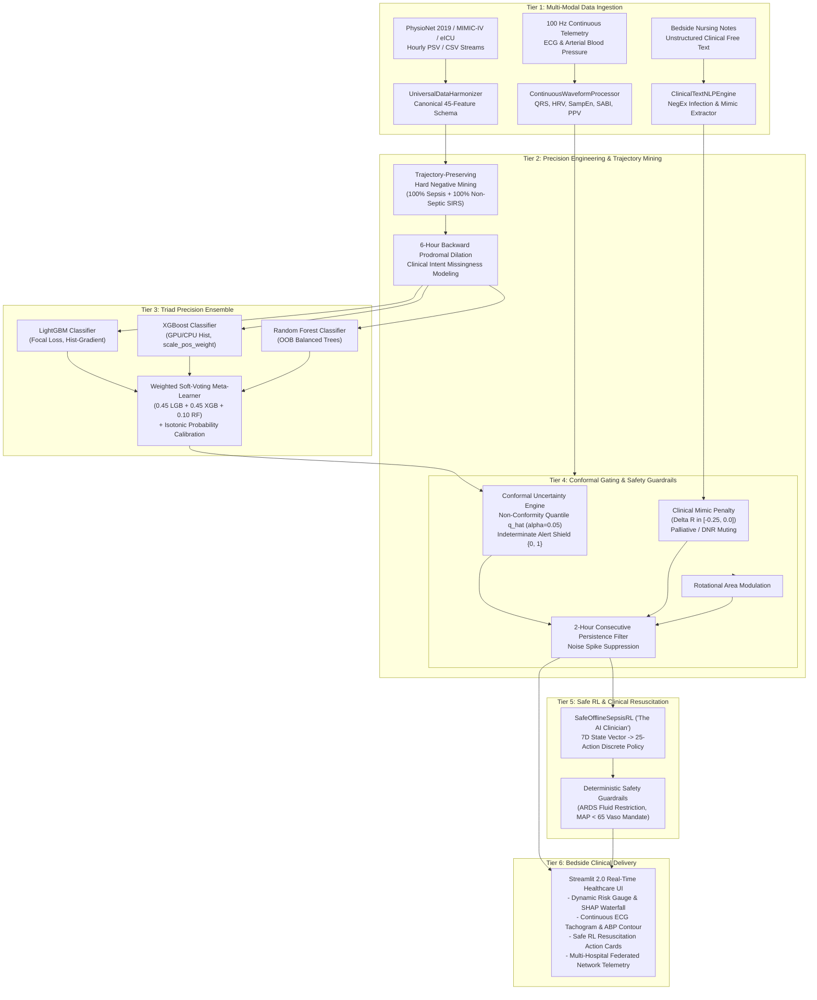

# 🩺 SepsisSense — Early Sepsis Prediction with Alarm-Fatigue-Aware Safety Layers (Research Prototype)

[](https://github.com/suriyaprakash-25/SepsisSense)
[-success?style=for-the-badge&logo=pytest)](https://github.com/suriyaprakash-25/SepsisSense)
[](https://www.python.org/)
[](https://streamlit.io/)
[](https://xgboost.readthedocs.io/)
[](LICENSE)

**SepsisSense** is a research prototype for early sepsis prediction in the ICU, trained and evaluated on the **PhysioNet/CinC 2019 Challenge** dataset (Sepsis-3 labels, hourly vitals and labs).

The project focuses on **clinician alarm fatigue**: it prioritises specificity and calibrated probabilities over raw sensitivity, then adds safety layers (conformal uncertainty gating and a persistence filter) to suppress unreliable alerts. Several further research directions (path signatures, clinical NLP, waveform HRV, federated learning, safe RL) are implemented as **prototype modules** and are not yet validated on real patient data. See [Validated Results](#-validated-results-held-out-physionet-2019) and [Limitations](#-limitations--honest-assessment).

---

## 📑 Table of Contents

- [Key Capabilities & Clinical Edge](#-key-capabilities--clinical-edge)
- [System Architecture](#-system-architecture)
- [Research Modules](#-research-modules)
- [Validated Results](#-validated-results-held-out-physionet-2019)
- [Limitations & Honest Assessment](#-limitations--honest-assessment)
- [Project Directory Structure](#-project-directory-structure)
- [Multimodal Bedside Clinical UI](#-multimodal-bedside-clinical-ui)
- [Automated Verification & Test Harness](#-automated-verification--test-harness)
- [Quickstart & Installation](#-quickstart--installation)
- [Clinical & Executive Reports](#-clinical--executive-reports)
- [Medical Disclaimer](#-medical-disclaimer)

---

## ⚡ Key Capabilities & Clinical Edge

Status key: ✅ trained & evaluated on real PhysioNet data · 🧪 implemented & unit-tested, demonstrated on synthetic/simulated data only

1. ✅ **Precision-oriented ensemble**: LightGBM + XGBoost + Random Forest soft-voting ensemble with isotonic calibration. ROC-AUC 0.803 on the internal validation split and **0.685 on 1,500 unseen stays** (see [results](#-validated-results-held-out-physionet-2019)).
2. ✅ **Early-warning labelling**: 6-hour backward label dilation, so the model is trained to flag the hours *before* Sepsis-3 onset.
3. ✅ **Imbalance handling**: trajectory-preserving hard negative mining keeps all septic and non-septic SIRS ("look-alike") patients.
4. ✅ **Missingness-as-signal features**: lab-ordering patterns used as a proxy for clinical suspicion.
5. ✅ **2-hour persistence filter**: an alert must persist across consecutive hours, which suppresses isolated sensor spikes.
6. 🧪 **Conformal uncertainty gating**: split-conformal prediction sets (α = 0.05); alerts are withheld when the set is indeterminate ($\Gamma = \{0, 1\}$).
7. 🧪 **Rough path signatures**: Level-1/Level-2 iterated integrals and (HR, MAP) Lévy area as features robust to irregular sampling.
8. 🧪 **Clinical-note NLP**: rule-based phrase matching with NegEx negation to flag infection signs and sepsis mimics (post-op pain, anxiety, ambulation).
9. 🧪 **Waveform analytics**: Pan-Tompkins QRS detection, time/frequency HRV, Sample Entropy and ABP pulse-pressure variation. No real 100 Hz ICU waveforms have been used yet.
10. 🧪 **Federated learning with DP-SGD**: simulated 4-node federation (logistic model, L2 clipping, Gaussian noise). It does **not** train on MIMIC-IV / eICU / HiRID; the node names are labels in the simulation.
11. 🧪 **Safe-RL treatment recommender**: a 7-D state and a 25-action (fluid × vasopressor) grid, bounded by Surviving Sepsis Campaign guardrails. **The Q-function is not trained** (random initialisation), so recommendations are currently driven by the deterministic guardrails.

---

## 🏛 System Architecture



---

## 🔬 Research Modules

> All six modules below are **🧪 prototypes**: implemented and unit-tested, but not yet integrated into the trained pipeline or validated on real patient data. The literature listed under "Inspiration" motivated each design; this project does not reproduce those papers' results.

### 1. Conformal Uncertainty Filtering
* **Inspiration**: COMPOSER (Shashikumar, Nemati et al., *npj Digital Medicine*, UC San Diego).
* **Status**: 🧪 Tested on synthetic data; not yet calibrated on the held-out PhysioNet split.
* **Module**: [`src/conformal_uncertainty.py`](src/conformal_uncertainty.py)
* **Mechanism**: Solves for conformal non-conformity quantile $\hat{q}$ on hold-out calibration data at significance level $\alpha = 0.05$ (guaranteeing 95% marginal coverage). Produces prediction sets $\Gamma^{0.05}(\mathbf{x}) \subseteq \{0, 1\}$. When ensemble trees diverge ($\sigma_{\text{ensemble}} > 0.15$), outputs **$\Gamma = \{0, 1\}$ [Indeterminate]** and suppresses the alert, instructing clinicians: *"Uncertainty elevated. Alert withheld to prevent alarm fatigue. Re-check serum lactate and vitals."*

### 2. Rough Path Signatures & Hemodynamic Shock Loops
* **Inspiration**: Signature-based approach of the PhysioNet/CinC 2019 winning team (Morrill, Kormilitzin, Lyons et al., Oxford).
* **Status**: 🧪 Feature extractor implemented and tested; not yet added to the trained model's feature set.
* **Module**: [`src/path_signatures.py`](src/path_signatures.py)
* **Mechanism**: Models irregular vital streams as geometric paths $X(t) = (t, \text{HR}, \text{MAP}, \text{Resp}, \text{Temp})$. Extracts Level-1 displacements and Level-2 iterated integrals:
  $$A_{i, j} = \frac{1}{2} \int_0^T \Big( (X_i(s) - X_i(0)) dX_j(s) - (X_j(s) - X_j(0)) dX_i(s) \Big)$$
  The $(HR, MAP)$ **Shock Loop Area** isolates the rotational phase-space trajectory of circulatory collapse (tachycardia with collapsing blood pressure) from benign exertion (concordant HR and BP increases).

### 3. Bedside Clinical Text NLP (NegEx Integration)
* **Inspiration**: NegEx (Chapman et al., 2001) and clinical literature on sepsis mimics.
* **Status**: 🧪 Rule-based; tested on hand-written example notes. PhysioNet 2019 has no free text, so it has not been evaluated on real notes (MIMIC-IV-Note would be the next step).
* **Module**: [`src/clinical_nlp.py`](src/clinical_nlp.py)
* **Mechanism**: Parses unstructured nursing shift notes using rule-based phrase matchers and NegEx negation scope detection:
  * **Infection Phenotypes**: Detects altered mental status, mottled extremities, rigors, purulent sputum, and urosepsis.
  * **Mimic Disambiguation**: Identifies post-operative pain, panic/anxiety, and physical therapy ambulation, applying risk modulation ($\Delta R \in [-0.25, 0.0]$) to prevent false alerts.
  * **Palliative Care Shield**: Automatically mutes alarms for Comfort Measures Only (CMO) or Do Not Resuscitate (DNR) patients.

### 4. Continuous Waveform High-Frequency Ingestion (ECG & ABP)
* **Inspiration**: Pan & Tompkins (1985) QRS detection; literature linking reduced HRV and entropy to sepsis.
* **Status**: 🧪 Signal-processing functions tested on generated ECG/ABP signals. No real ICU waveform data (e.g. MIMIC-III Waveform) has been processed yet, and no lead-time claim has been validated.
* **Module**: [`src/waveform_analytics.py`](src/waveform_analytics.py)
* **Mechanism**: Designed for 100 Hz telemetry. Extracts Pan-Tompkins QRS complexes, time-domain HRV (SDNN, RMSSD, pNN50), Welch spectral power (LF, HF, LF/HF) and Sample Entropy. From arterial blood pressure (ABP) it measures pulse pressure variation (PPV ≥ 13% suggests fluid responsiveness) and $dP/dt_{\max}$. The dashboard shows an illustrative autonomic-blunting score derived from these features.

### 5. Multi-Center Federated Learning with Differential Privacy
* **Status**: 🧪 **Simulation only.** Four in-process "hospital" clients holding synthetic non-IID data train a logistic-regression model. No real multi-centre data is involved; the hospital names (MIMIC-IV, AmsterdamUMCdb, eICU, HiRID) are labels in the simulation.
* **Module**: [`src/federated_learning.py`](src/federated_learning.py)
* **Mechanism**:
  * Client-side DP-SGD: $L_2$ gradient clipping ($C = 1.0$) and Gaussian noise injection.
  * A simple cumulative ε counter (not a formal Rényi-DP accountant).
  * FedAvg-style aggregation weighted by client sample size.
  * **Known issue**: the FedProx proximal term currently evaluates to zero (`global_weights - global_weights`), so the code behaves as FedAvg.

### 6. Safe Offline Reinforcement Learning ("The AI Clinician")
* **Inspiration**: The AI Clinician (Komorowski et al., *Nature Medicine* 2018) and the Surviving Sepsis Campaign 2021 guidelines.
* **Status**: 🧪 **The Q-function is untrained** (random initialisation; no offline-RL training loop exists yet). Recommendations are currently driven by the deterministic guardrails below. Training with Conservative Q-Learning on MIMIC-IV trajectories is future work.
* **Module**: [`src/safe_reinforcement_learning.py`](src/safe_reinforcement_learning.py)
* **Mechanism**: Evaluates a 7D normalized clinical state vector $(\text{MAP}, \text{Lactate}, \text{Shock Index}, \text{SOFA}, PaO_2/FiO_2, \text{Urine Output}, \text{Fluid Balance})$ over a 25-action grid (5 fluid tiers $\times$ 5 vasopressor tiers), bounded by hard clinical safety guardrails:
  * **ARDS / Hypoxemia**: Fluid capped to $\le 250\,\text{mL}$ when $PaO_2/FiO_2 < 200$.
  * **Hypervolemia**: Fluid prohibited when cumulative balance $> 5,000\,\text{mL}$.
  * **Refractory Shock**: Vasopressors unconditionally initiated when $\text{MAP} < 65\,\text{mmHg}$.
  * **Weaning**: Active vasopressor taper when $\text{MAP} \ge 75\,\text{mmHg}$ and $\text{Lactate} < 1.5\,\text{mmol/L}$.

---

## 📊 Validated Results (held-out PhysioNet 2019)

Two evaluations are reported. The **unseen pool** is the more trustworthy one: those stays were never touched by training, and the metrics are recomputed from the saved model artifacts.

### Unseen pool: 1,500 stays never used in training

Source: computed by [`api/engine.py`](api/engine.py) when the web app first starts, and shown on its Model facts page.

**Cohort**: PhysioNet 2019 training set A, files `p010000`–`p011499`. Training read only the first 1,500 files of each set, so none of these stays were seen by the model. 1,500 stays · 57,723 hourly records · 138 septic stays (9.2%) · 1,322 positive hours (2.3%).

**Alert rule**: the uncalibrated ensemble score (the scale the 0.75 threshold was tuned on) must be ≥ 0.75 this hour *and* ≥ 0.64 (0.85 × threshold) in the previous hour, or ≥ 0.90 in a single hour. This is a causal version of the repository's persistence filter, which also looked one hour ahead.

| Metric | Value | Notes |
|:---|:---:|:---|
| ROC-AUC | **0.685** | Hour-level discrimination, calibrated risk |
| PR-AUC | **0.067** | About 2.9× the 0.023 positive-rate baseline |
| Precision (PPV) of alerts | **29.1%** | 32 TP / 110 alert hours |
| Recall (sensitivity) of alerts | **2.4%** | 32 / 1,322 positive hours detected |
| Specificity | **99.86%** | 78 false-positive hours out of 56,401 negative hours |
| Septic stays with ≥ 1 alert | **9 / 138 (6.5%)** | Patient level |
| Non-septic stays with ≥ 1 alert | **0 / 1,362** | Patient level |

**Confusion matrix (hours)**: TN 56,323 · FP 78 · FN 1,290 · TP 32

All 78 false-positive alert hours came from stays that did become septic, but more than 6 hours before onset (outside the labelled window). No non-septic patient triggered an alert.

### Internal validation split (from the training run)

Source: [`models/precision_metrics.json`](models/precision_metrics.json), produced by [`src/train_precision_model.py`](src/train_precision_model.py).

**Cohort**: 3,000 patients from PhysioNet 2019 Sets A + B · 115,974 hourly records · 226 sepsis patients (7.5%). The validation split has 22,551 hourly rows, of which 424 (1.9%) are positive.

| Metric | Value | Notes |
|:---|:---:|:---|
| ROC-AUC | **0.803** | Hour-level discrimination |
| PR-AUC | **0.092** | About 5× the 0.019 positive-rate baseline |
| Brier score | **0.0176** | Well calibrated after isotonic regression |
| Specificity @ t = 0.75 | **99.72%** | 61 false positives out of 22,127 negative hours |
| Precision (PPV) @ t = 0.75 | **30.7%** | 27 TP / 88 alerts. The 75% precision target was **not** reached |
| Recall (sensitivity) @ t = 0.75 | **6.4%** | 27 / 424 positive hours detected |
| F1 @ t = 0.75 | 0.105 | |
| PhysioNet 2019 normalised utility | **−0.73** | Below the "never alert" baseline of 0; the challenge winner scored about 0.36 on the hidden test set |

**Confusion matrix (t = 0.75)**: TN 22,066 · FP 61 · FN 397 · TP 27

> ⚠️ The alert metrics in this table cannot be reproduced from the saved model. The training script applies the 0.75 threshold to the **calibrated** score, but the saved isotonic calibrator never outputs more than 0.385, so that rule produces zero alerts. The 88 alerts reported here likely come from a different run or calibrator. The threshold-free metrics (ROC-AUC, PR-AUC, Brier) are not affected by this.

### What this means

- **Discrimination drops on unseen data**: ROC-AUC falls from 0.803 (internal) to 0.685 (unseen pool). Expect real-world performance closer to the lower figure.
- **The operating point is far too conservative**: alerts are fairly precise (about 3 in 10 alert hours are within 6 h of onset, and no non-septic patient was alerted), but they catch only 2–6% of pre-sepsis hours and 6.5% of septic patients. A low score does **not** rule out sepsis.
- **Next steps**: choose the threshold to maximise the PhysioNet utility score, report patient-level detection and lead time, and fix the threshold/calibration mismatch in the training script.

> ⚠️ `demo_output/demo_results.json` reports AUC ≈ 0.9998. That run uses the **synthetic** cohort from `src/preprocess.py` and does not reflect real-world performance.

---

## 🧭 Limitations & Honest Assessment

- **Single dataset**: the unseen-pool check uses more stays from the same PhysioNet hospital system, which is not true external validation (e.g. test on MIMIC-IV / eICU).
- **Training-pipeline issues** found while building the web app: the alert threshold is tuned on the uncalibrated score but applied to the calibrated one; the persistence filter looks one hour into the future; the "lab-ordering" features are computed after forward-fill, so they only encode whether a lab was ever charted; the saved conformal quantile (0.25) yields empty prediction sets for most scores.
- **Limited patient-level evaluation**: the unseen pool reports septic stays alerted (9 / 138), but median lead time has not been measured yet.
- **Shortcut learning on length of stay**: identical vitals score about 5% at ICU hour 30 and about 28% at hour 120, because longer PhysioNet stays carry more sepsis labels. A fair model should be retrained without `ICULOS`/`HospAdmTime`, or with them controlled for, and the effect re-measured.
- **Precision/recall trade-off unresolved**: the threshold was set for a precision target and was not tuned to the clinical utility function.
- **Prototype modules are not in the trained pipeline**: conformal gating, signatures, NLP, waveforms, federated learning and RL are tested on synthetic inputs only (see status markers above).
- **No subgroup / fairness analysis**, no prospective or silent-mode evaluation.
- **Next steps**: utility-optimal thresholding; patient-level metrics; external validation on MIMIC-IV; adding signature features to the ensemble and measuring their contribution; conformal calibration on real held-out data; sequence models for irregular time series (e.g. GRU-D) as a comparison.

---

## 📁 Project Directory Structure

```
SepsisSense/
├── app/
│   └── streamlit_app.py                   # 4-page clinical UI with multimodal tabs
├── models/
│   ├── sepsissense_precision_ensemble.pkl # Triad ensemble (LGBM + XGB + RF)
│   ├── sepsissense_xgb.pkl                # Trained XGBoost baseline
│   ├── feature_columns.pkl                # Canonical 52-feature schema
│   └── precision_curve_summary.png        # PR-curve & confusion matrix visualization
├── notebooks/
│   ├── 01_eda.ipynb                       # Exploratory data analysis
│   ├── 02_feature_eng.ipynb               # Feature engineering experiments
│   ├── 03_modeling.ipynb                  # Multi-model benchmarking
│   └── 04_train_pipeline.ipynb            # Retraining pipeline notebook
├── src/
│   ├── clinical_nlp.py                    # NegEx clinical text NLP & mimic suppression
│   ├── conformal_uncertainty.py           # Conformal prediction & epistemic uncertainty
│   ├── federated_learning.py              # DP-SGD multi-center federated network & FedProx
│   ├── path_signatures.py                 # Rough path signatures & shock loop integrals
│   ├── precision_engineering.py           # Hard negative mining, dilation, persistence
│   ├── precision_ensemble.py              # Triad ensemble & isotonic calibrator
│   ├── safe_reinforcement_learning.py     # Safe RL "AI Clinician" & Surviving Sepsis bounds
│   ├── waveform_analytics.py              # Continuous ECG/ABP waveforms, HRV, SampEn, PPV
│   ├── preprocess.py                      # Preprocessor & synthetic cohort generator
│   ├── feature_engineering.py             # 52 production features, SOFA, rolling stats
│   ├── train_model.py                     # Multi-center dataset training pipeline
│   └── explain_model.py                   # SHAP TreeExplainer & waterfall charts
├── tests/
│   ├── test_conformal_and_signatures.py   # Conformal calibration & path signature tests
│   ├── test_future_directions.py          # Continuous waveforms, federated DP, safe RL tests
│   └── test_precision_pipeline.py         # Harmonizer, utility, hard negative mining tests
├── test_app.py                            # Production feature schema & smoke tests
├── test_demo.py                           # Trajectory generation & scenario tests
├── generate_sepsissense_v2_pdf.py         # ReportLab PDF report generation script
├── SEPSISSENSE_V2_REPORT.md               # Technical & non-technical v2 architecture report
├── SEPSISSENSE_V2_REPORT.pdf              # 187 KB formatted clinical executive PDF
├── requirements.txt                       # Python dependencies
└── README.md                              # Main documentation (this file)
```

---

## 🖥 Multimodal Bedside Clinical UI

Launch the clinical dashboard locally:
```bash
streamlit run app/streamlit_app.py
```

### Dashboard Tabs & Pages:
1. **📊 Dashboard**: Real-time multi-center metrics, animated risk gauges, and trajectory timeline.
2. **🩺 Predict Risk (4 Multimodal Prediction Panels)**:
   * **Tab 1: Structured Vitals & Labs** — Hourly sliding windows, physiological ranges, and SHAP waterfall explainability.
   * **Tab 2: Bedside Clinical Text NLP** — Nurse shift note ingestion, NegEx negation scope highlighter, and physiological mimic risk penalty.
   * **Tab 3: Rough Path Signatures** — 2D $(HR, MAP)$ phase-space portrait, Lévy area rotational loop, and time-invariance metrics.
   * **Tab 4: Continuous Waveforms & Safe RL**:
     * Live 100 Hz Lead II ECG tachogram & ABP pulse contour.
     * Real-time HRV metrics (SDNN, RMSSD, Welch LF/HF, Sample Entropy, PPV).
     * Sepsis Autonomic Blunting Alert ($SABI > 0.60$).
     * Safe RL "AI Clinician" resuscitation recommendation card with Surviving Sepsis Campaign safety guardrails.
3. **📈 Analytics & Multi-Center Federated Network**:
   * Precision-Recall operating curves and confusion matrix.
   * **Federated Network Card (simulated)**: Illustrates the federated-learning prototype with simulated hospital nodes and a cumulative ε counter. The AUC figures shown there come from simulated data and are not clinical results.
4. **🩺 About**: System documentation, clinical governance, and regulatory disclaimers.

---

## 🧪 Automated Verification & Test Harness

SepsisSense ships with **42 automated tests across 5 test files** (`test_app.py`, `test_demo.py`, `tests/test_conformal_and_signatures.py`, `tests/test_future_directions.py`, `tests/test_precision_pipeline.py`). All 42 pass (last run: 42 passed in 52 s, Python 3.11, Windows).

```bash
pytest -v
```

The tests check that code runs correctly (schema, probability bounds, guardrail logic, conformal coverage on synthetic data, and so on). They are **not** evidence of clinical performance; see [Validated Results](#-validated-results-held-out-physionet-2019) for that.

---

## 🚀 Quickstart & Installation

### 1. Clone the Repository
```bash
git clone https://github.com/suriyaprakash-25/SepsisSense.git
cd SepsisSense
```

### 2. Create Virtual Environment & Install Dependencies
```bash
python -m venv venv
# On Windows:
.\venv\Scripts\activate
# On Linux / macOS:
source venv/bin/activate

pip install -r requirements.txt
```

### 3. Run Test Suite
```bash
pytest -v
```

### 4. Launch the clinician web app (recommended)

A React + TypeScript interface designed for ICU clinicians, backed by a FastAPI service that scores **real, de-identified PhysioNet 2019 stays the model never saw in training** (files p010000 and later). Requires Node.js 18+ and the PhysioNet training set A under `physionet.org/` (see [DATA_DOWNLOAD.md](DATA_DOWNLOAD.md)).

```bash
# one-time: build the UI
cd frontend && npm install && npm run build && cd ..

# serve API + UI (first start scores a 1,500-stay pool and caches it, ~1 min)
uvicorn api.main:app --port 8000
```
Open [http://localhost:8000](http://localhost:8000). For UI development with hot reload, run `npm run dev` in `frontend/` (port 5173, proxies `/api` to port 8000).

What clinicians get:
- **Ward overview**: patients sorted by who needs attention first, risk with 12 h trend, vitals with H/L flags and stale-data markers, lactate recency, filter tiles (alerts, elevated, rising, vitals overdue), keyboard navigation.
- **Patient view**: risk timeline you can scrub back through, vitals small-multiples with reference bands, labs with recency and trends, the "what is driving this score" panel (grouped TreeSHAP), Surviving Sepsis Campaign Hour-1 checklist, SIRS/qSOFA, and an alert review workflow with reasons.
- **New assessment**: enter vitals and labs for your own patient in a flowsheet (oldest reading on the left, now on the right) and get the same risk card, drivers, SIRS/qSOFA and Hour-1 checklist. Add up to 6 time points within the last 24 h so the model sees real trends; values are range-checked as you type, and the result warns when inputs are thin (one time point, no lactate) or when time in ICU dominates the score. Readings are placed on an hourly grid and run through the training feature pipeline, with missing values filled from training-era medians.
- **Model facts**: intended use, performance on the unseen pool vs. internal validation, and known limitations.
- Night mode, an hour-by-hour replay clock, and an optional research view showing retrospective Sepsis-3 labels.

Design notes: low risk is shown in neutral grey, never green, because the model misses most septic patients; red and amber are reserved for alerts and abnormal values. The API applies the alert threshold on the scale it was tuned on (uncalibrated score), uses a causal persistence filter, and reports pool metrics live; see the Model facts page.

### 5. Legacy Streamlit app
```bash
streamlit run app/streamlit_app.py
```
Open [http://localhost:8501](http://localhost:8501) in your browser.

---

## 📑 Clinical & Executive Reports

Comprehensive architecture and evaluation reports are provided in both Markdown and formatted PDF formats:
* **Markdown Architectural Blueprint**: [`SEPSISSENSE_V2_REPORT.md`](SEPSISSENSE_V2_REPORT.md)
* **Formatted Professional PDF (ReportLab)**: [`SEPSISSENSE_V2_REPORT.pdf`](SEPSISSENSE_V2_REPORT.pdf)
* **Recompile PDF**:
  ```bash
  python generate_sepsissense_v2_pdf.py
  ```

---

## ⚠️ Medical Disclaimer

**IMPORTANT NOTICE**: *SepsisSense is an advanced artificial intelligence research prototype and clinical decision support framework. It is intended for investigational, research, and educational purposes. It is not an FDA-cleared or CE-marked medical device and must never supersede clinical judgment, bedside patient assessment, or established institutional resuscitation bundles.*

---

**Release Version**: `v1.7`  
**License**: MIT  
**Remote Repository**: [https://github.com/suriyaprakash-25/SepsisSense](https://github.com/suriyaprakash-25/SepsisSense)
